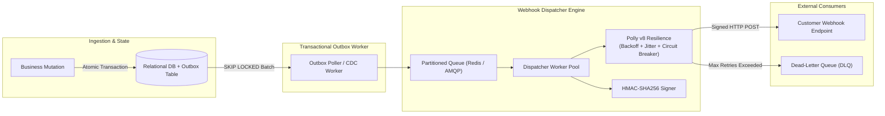

# Resilient Webhook Delivery Platform

[](https://github.com/kdmbhushan/resilient-webhook-platform/actions)
[](LICENSE)
[](https://dotnet.microsoft.com/)

> High-throughput asynchronous messaging architecture and webhook delivery platform built in C# .NET with Transactional Outbox pattern, Azure Service Bus / Redis backplanes, Polly v8 exponential backoff with full jitter, and HMAC-SHA256 signature verification.

📖 **Companion Deep Dive**: [Transactional Outbox & Resilient Messaging on Azure Service Bus](https://bhushankadam.dev/blog/azure-servicebus-outbox-pattern) on [bhushankadam.dev](https://bhushankadam.dev)

---

## 1. Problem Statement

In distributed microservices, delivering asynchronous webhooks to third-party customer endpoints with unpredictable latencies, slow responses, and transient failures causes outbound worker pool exhaustion, cascading failure across producer services, and security vulnerabilities without tamper-proof cryptographic signatures.

Simultaneously, dual-write operations between relational databases and message brokers inevitably cause split-brain data corruption when network partitions occur between the database commit and message dispatch.

---

## 2. Architecture



---

## 3. Project Structure

```text
resilient-webhook-platform/
├── .github/workflows/
│   └── ci.yml                 # Automated build, test, and formatting verification
├── src/
│   ├── ResilientWebhook.Core/       # Domain entities: OutboxMessage, WebhookSubscription
│   ├── ResilientWebhook.Publisher/  # Transactional outbox background relay service
│   └── ResilientWebhook.Dispatcher/ # Webhook HTTP client, Polly policies, and HMAC-SHA256 signer
├── tests/
│   └── ResilientWebhook.Tests/      # Unit and verification test suites
└── README.md
```

---

## 4. Quickstart

### Build Solution
```bash
dotnet build
```

### Run Tests
```bash
dotnet test
```

---

## 5. Security & Authenticity Disclosures

- **Zero Fabricated Claims**: This repository is a clean, reproducible reference implementation. It does not claim fictional enterprise client deployments.
- **Deterministic Validation**: All tests run locally without requiring third-party cloud subscriptions or paid external services.

---

## 6. License

Licensed under the [MIT License](LICENSE). Copyright &copy; 2026 Bhushan Kadam.
